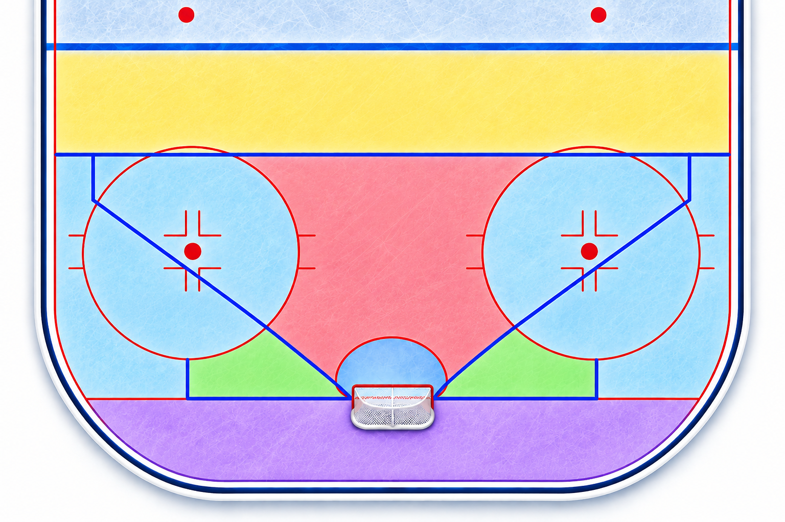

# Spela situationen
## Spelidé och placering för målvakter

**Målvaktsansvariga SSK**

Erik Åström  
Mathias Larsson

---

# Målvaktens ansvar
**Du är mer än den som räddar puckar.**

### Styr försvaret
- Du ser spelet framför dig.
- Kommunicera och hjälp dina medspelare.
- Skapa trygghet och tydlighet.

### Bär laget när det går tungt
- Behåll lugnet när laget är pressat.
- Fortsätt tävla – oavsett resultat.
- Visa med ditt agerande att laget kan lita på dig.

---

# Från hotbild till spelidé

Förra teoripasset: **Hotbild**

Nu tar vi nästa steg.

**Hur vill jag spela situationen?**

- Var är pucken?
- Hur hanteras pucken?
- Vilka hot finns?
- Hur ska jag placera mig?

---

# Vad är en spelidé?

En spelidé hjälper mig att fatta beslut.

- Var vill jag vara placerad?
- Hur mycket djup behöver jag?
- När ska jag förflytta mig?
- När ska jag stå kvar?
- Vilken teknik passar situationen?

> Jag ska veta varför jag väljer mitt agerande.

---

# Placering är ett aktivt val

**Rätt placering handlar inte bara om att täcka pucken.**

Jag behöver också kunna hantera nästa situation.
- Vinkel
- Djup
- Balans
- Beredskap
- Förflyttningsmöjligheter

> En bra placering ger mig flera alternativ.

---

# Spelzoner

**Utgångspunkt för diskussion:**

- 🟨 **Gul – Yttre zon:** 
- 🟥 **Röd – Farligt område:** 
- 🟦 **Blå – Dålig vinkel:** 
- 🟩 **Grön – Stolpspel:** 
- 🟪 **Lila – Bakom mål:** 

---

# Zonen ger en utgångspunkt

**Samma zon – olika situationer.**

- Har puckföraren kontroll?
- Finns möjlighet att skjuta?
- Finns passningsalternativ?
- Är puckföraren pressad?
- Hur agerar mina försvarare?

> Hotbilden avgör hur jag anpassar mig.

---

<!-- _class: situation -->

# Hur vill du spela?

---
<!-- _class: situation -->

# Spela situationen
## Inte bara pucken

