<!-- _class: title -->

# Se spelet före det händer

## Scanning, hotbild och spelförståelse för målvakter

Målvaktsansvariga SSK
**Erik Åström** 
**Mathias Larsson**

---

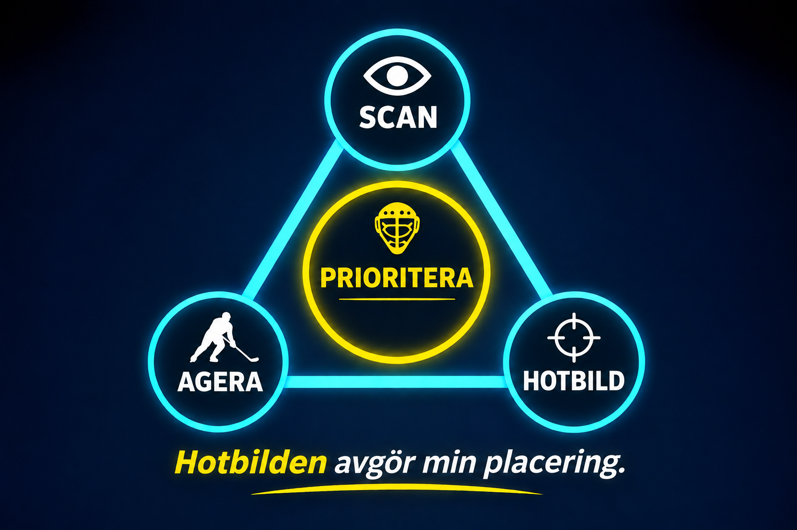

---

# Primärt hot

## 🔴 Puckföraren

Det primära hotet är spelaren som **kan påverka situationen direkt**.

### Vad kan hända?

- Skott
- Genombrott
- Passning

---

# Men pucken är inte hela spelet

<!-- Här använder vi rinkdiagram -->

## Vad händer om pucken flyttas?

---

# Sekundära hot

Spelare utan puck som kan bli **nästa primära hot**.

### Sök efter

**Bortre stolpen** · **Slottet** · **Bakom mål** · **Sen spelare**

> Vem blir farlig om pucken flyttas?

---

# Scanning

## Puck → Scan → Puck

<!-- **PUCK** → 👀 **SÖK HOT** → **PUCK** -->

Scanning är en **kort blick bort från pucken** för att hämta information.

> **Vad behöver jag veta innan pucken flyttas?**

---

# Bygg hotbilden

Varje scan ger ny information.

## Vad letar jag efter?

**Spelare** – var finns hoten?

**Klubb & kropp** – skott, pass eller rörelse?

**Egna backar** – vad tar de bort?

**Lediga ytor** – var kan nästa hot uppstå?

> Se det som hjälper dig läsa nästa situation.

---

<!-- _class: question -->

# Spelförståelse

## Vad kommer att hända härnäst?

**Se pucken.**  
**Sök hoten.**  
**Läs spelet.**

Hotbilden påverkar:

**Placering · Djup · Beredskap · Nästa agerande**

> Var förberedd innan det händer.
---

<!-- _class: situation -->

# Var finns hoten?

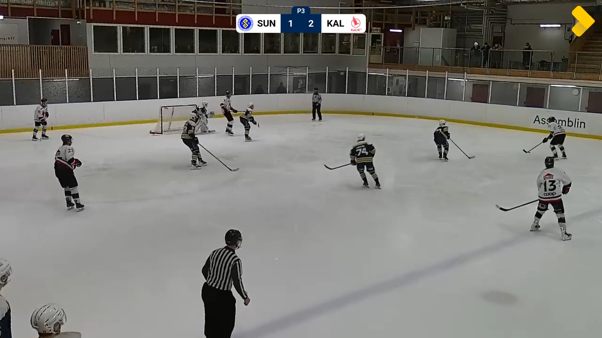

---

<!-- _class: situation -->

# Vad hände...

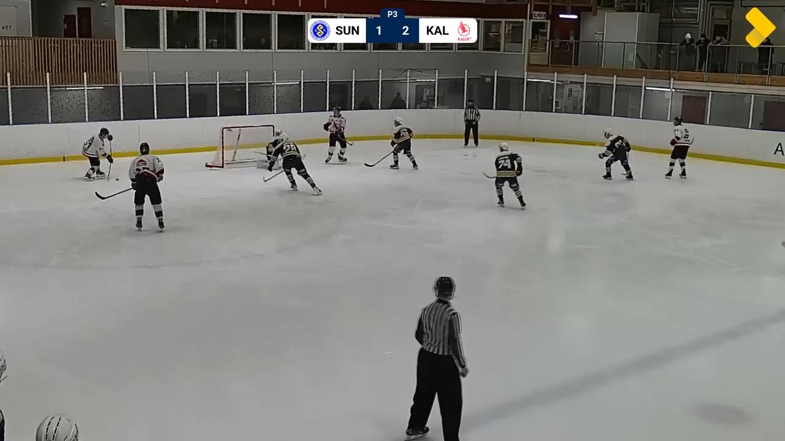

---

<!-- _class: situation -->

# Var finns hoten?

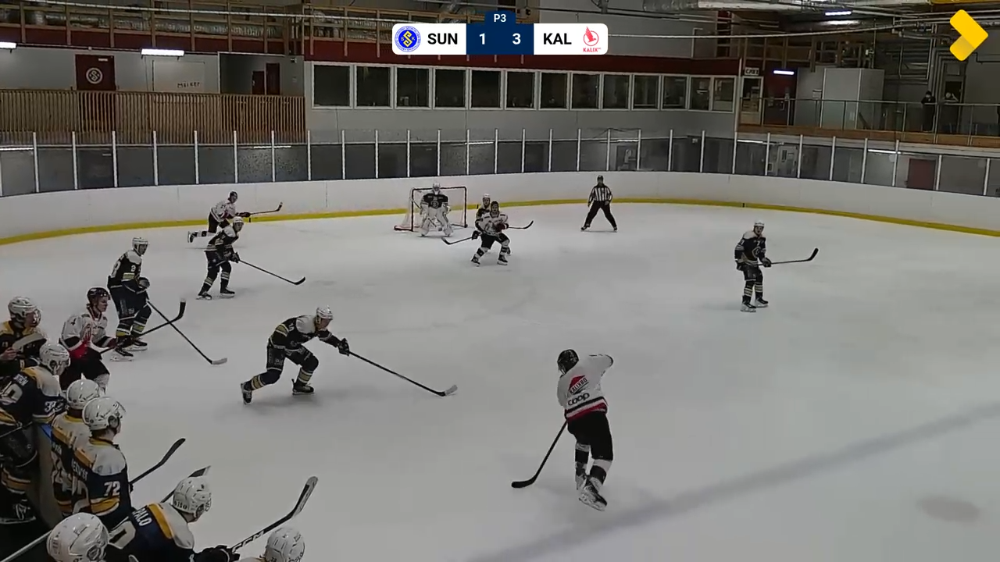

---

<!-- _class: answer -->

# Vad hände...

  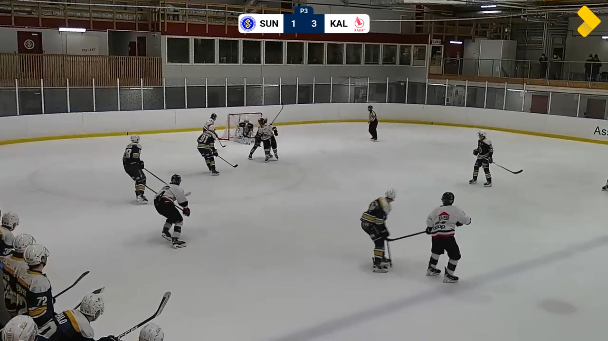
  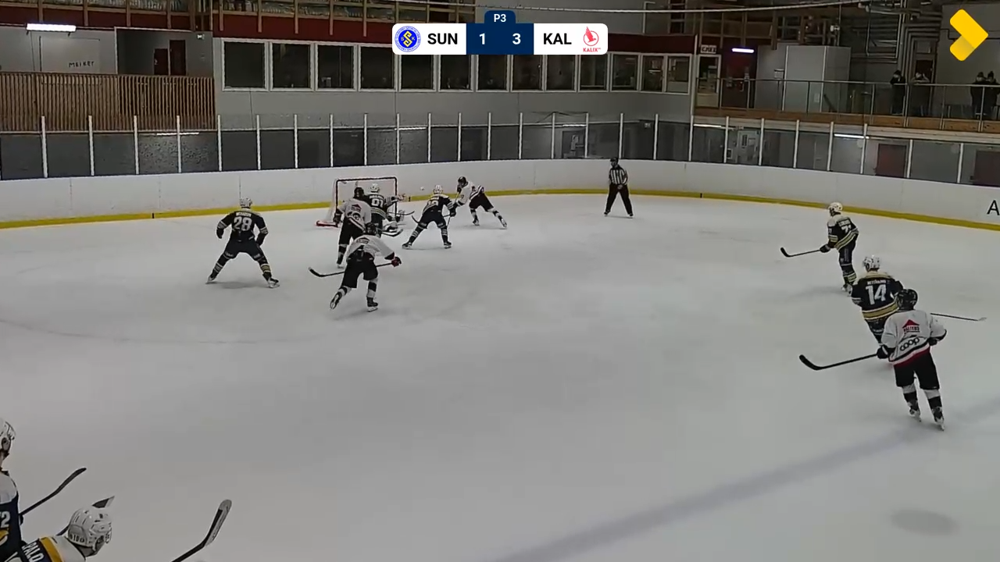

---

<!-- _class: situation -->

# Var finns hoten?

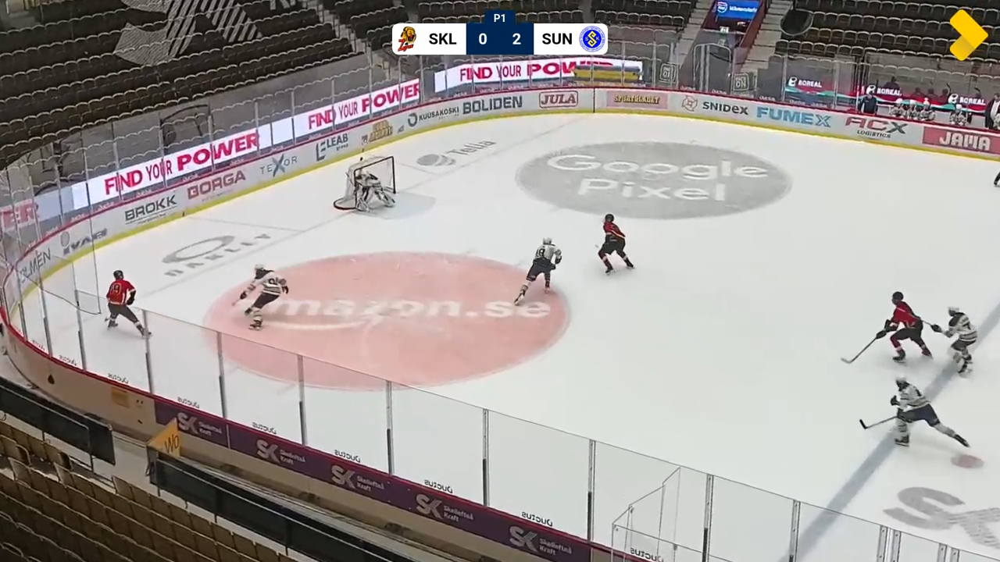

---

<!-- _class: answer -->

# Vad hände...

  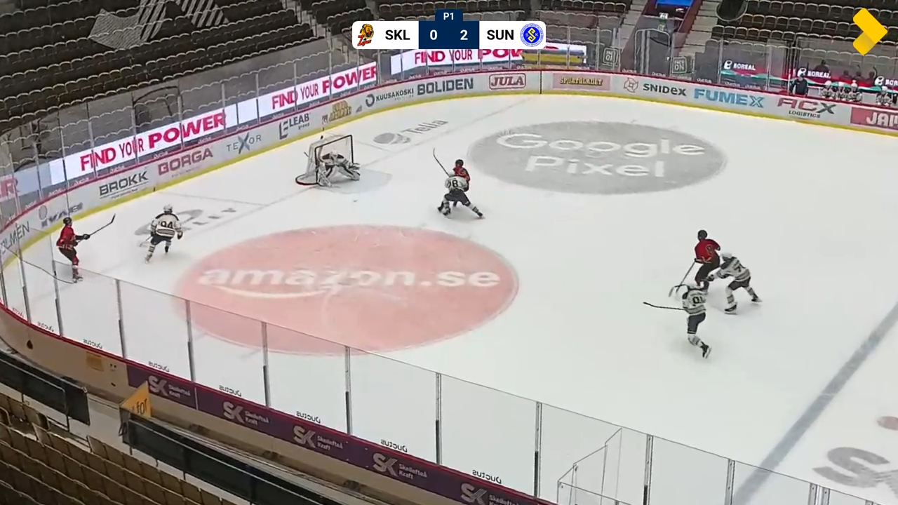
  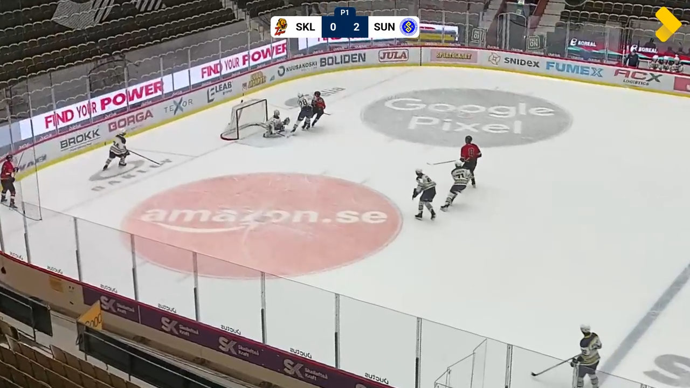

---

# Ispass 13:30

Övningar

---

<!-- _class: situation -->

# Övning 1 – Backens val

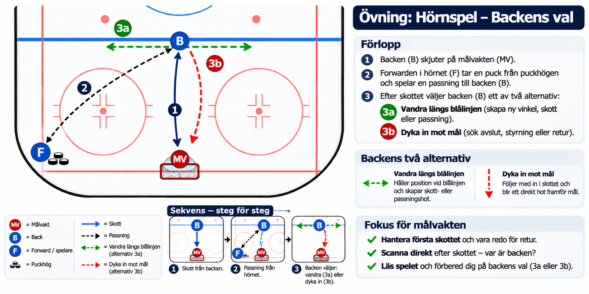

---

<!-- _class: situation -->

# Övning 2 – Flera hot

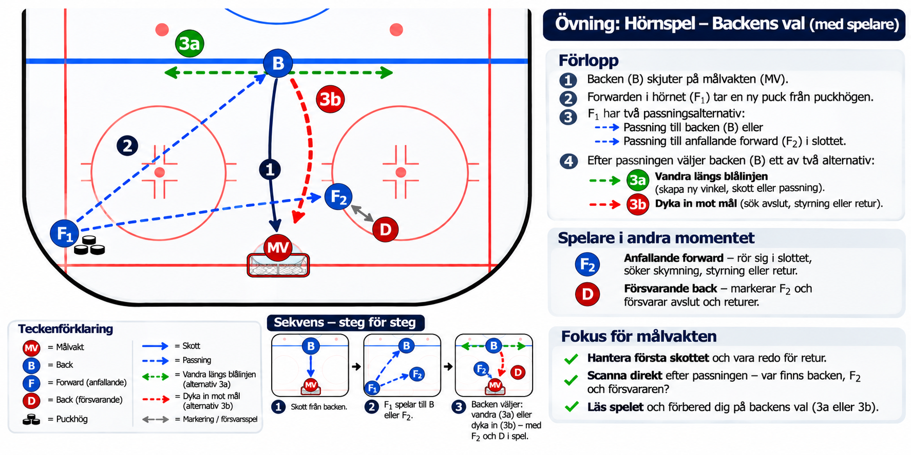

---

<!-- _class: situation -->

# Övning 3 – Kreativ forward

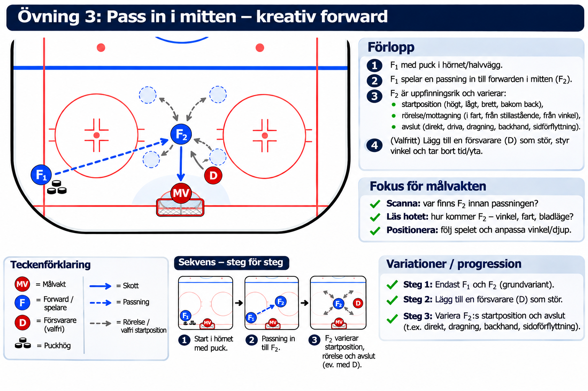

---

